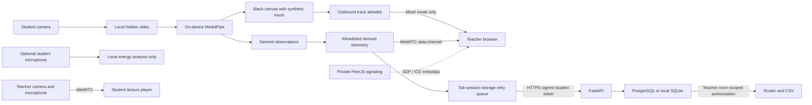

# EduGuard privacy and security

## Scope and explicit choices

Student inference runs in on-device MediaPipe/WebAssembly. Consent is required before the classroom iframe starts capture or monitoring. A signed, room-specific invitation (12-hour expiry) and an explicit privacy mode are required for API admission. Use a display alias rather than a legal name.

1. **Synthetic mesh:** a black canvas with derived facial mesh is the only permitted student outbound video source. No student microphone audio is sent.
2. **Telemetry only:** no student video or audio tracks are attached to the outgoing WebRTC connection. Receive-only transceivers still receive the teacher lecture. Camera frames may still be processed locally to derive telemetry; this mode is not camera-off monitoring.

Microphone analysis is separately opt-in. It requests a local audio track only when enabled, never adds it to the outgoing media stream, and stops it when disabled. There is no recording, transcription or microphone audio upload. The retained mic-toggle UI cannot create a transmitted audio track. Teacher audio/video are intentionally broadcast.

Neither mode is anonymous or zero-data. Mesh geometry, head pose, timing, display aliases, network addresses and behavioral telemetry can identify people or reveal sensitive patterns. Energy is not a speech classifier. Observations are not evidence of attention, intent or misconduct.

## Data flow

## Inventory and browser/API audit

| Data/API | Processing and transmission | Storage |
| --- | --- | --- |
| Original student camera frames/tracks | getUserMedia, hidden video and MediaPipe input remain local; never supplied to peer.call/addTrack senders | Transient browser memory only |
| Mesh | Canvas drawing of landmarks, captureStream video; only mesh mode may attach allowlisted canvas track IDs | No application recording; recipients can independently record |
| Landmarks and precise geometry | Generated in browser; no landmark arrays accepted by API | No application database storage |
| Head pose, eye-closure flags, audio energy | Local estimates; derived observations can reach teacher over the data channel | API does not accept these extra fields; no raw audio arrays |
| Display alias, session/room IDs, timestamps, scalar scores, state, missing-data flag | Allowlisted HTTP telemetry and authorized roster/CSV | Database; pending derived samples in tab sessionStorage |
| Consent time and chosen mode | Recorded at admission; signed student token also includes consent and mode | Session database row |
| Original student microphone samples | Local Web Audio only after separate opt-in; no MediaRecorder or transcription | Transient browser audio buffers only |
| Teacher media | Intentionally transmitted to admitted room peers | Not recorded by app |
| Admission, session and room capabilities | Signed API tokens in Authorization headers; invitation in URL fragment, not query; pseudonymous random peer IDs | Tab sessionStorage and user-shared invitation links; signing secret stays server-side |
| Signaling, STUN, TURN | SDP, ICE, IP and connection metadata reach configured infrastructure; TURN may relay encrypted WebRTC media | Infrastructure logs/retention are operator-controlled |
| CDN/font/hosting requests | IP, user agent, timing and asset paths reach providers; MediaPipe models/WASM are downloaded, not camera frames | Third-party access logs, outside application deletion control |

The retired Streamlit runtime is not used. Its replacement postMessage bridge requires matching source window and exact origin. Student initialization validates consent, mode, room, alias and signaling shape. Teacher initialization validates room and signaling shape. Parent telemetry processing validates IDs, booleans, finite bounded scores and state length, and reconstructs an allowlisted scalar object. API schemas reject unknown sample fields. Teacher peer telemetry also has bounded field validation; routing uses the transport peer ID rather than a caller-supplied identity. It is not possible to upload arbitrary video or landmark fields through the supported telemetry schema. A malicious external client can still send arbitrary HTTP requests; schema rejection is not a claim that no attacker can send bytes to the server.

## Threat model and controls

| Threat | Controls and remaining limits |
| --- | --- |
| Accidental raw video transmission | Every outbound student call checks video track IDs against canvas provenance, rejects all raw/unrecognized video tracks, and rejects every media track in telemetry-only mode. Single local camera capture is reused by inference. |
| Outsider room guessing | Random 128-bit room IDs; signed expiring invitations; distinct HMAC-derived 256-bit signaling room capability returned only after admission. Invitation holders can join: links are bearer capabilities, not identity verification. |
| Student reading another session or teacher reports | Signed, expiring, role/room-scoped API tokens; student writes bind to server-issued session ID; teacher-only roster/CSV/closure; deleted or ended student sessions cannot ingest samples. Invitations cannot authenticate as session tokens. |
| Peer impersonation by an admitted participant | Random signaling room capability blocks casual outsiders, but all admitted participants share it. PeerJS media identity is NOT independently authenticated with per-participant certificates. A malicious admitted peer or compromised signaling host can impersonate peers. This residual risk requires an authenticated signaling/SFU architecture for hostile classrooms. |
| Forged iframe messages | Source/origin checks, schema checks and scalar reconstruction. Same-origin scripts and compromised CDN code remain trusted; iframe isolation is not a defense against a same-origin compromise. |
| Password guessing/config mistakes | No default password; startup requires a configured password of at least 12 characters and rejects admin123; constant-time comparison; bounded in-process login rate limit. Multi-worker/global abuse protection requires an edge/shared limiter. |
| Dependency compromise | npm lockfile pins versions/integrities; CDN entry scripts have pinned URLs and SRI. scripts/verify_cdn.py verifies committed hashes without updating them. Dynamic MediaPipe assets are version-pinned but not SRI-verified. A compromised browser, extension, host or build can defeat application invariants. |
| Disconnect/withdrawal | Leave terminates capture; class closure stops ingestion and polling unmounts media, normally within five seconds. After 30 seconds of failed student status verification, monitoring stops. Offline/malicious clients cannot be forcibly stopped by a remote server. |

## Retention and deletion

RETENTION_DAYS defaults to 7, minimum 1. A server background cleanup checks expired classrooms and deletes their samples, sessions and room every 60 seconds while the process is running; sleeping/offline hosts clean up after resumption. Expiry is measured from room creation. This is not a guaranteed wall-clock deletion deadline while a host is offline. Configure a monitored scheduled database cleanup for strict operational deadlines.

Students can withdraw and delete their own session and samples. Teachers can end and delete the whole room. Deletion revokes subsequent API access for removed sessions/rooms and removes local session/outbox keys in that browser. It does not delete third-party logs, exports, screenshots, recipient recordings, database backups, or old legacy eduguard_telemetry.db files. Operators must separately manage those copies and enforce backup expiry. API deletion and retention perform ordered transactional deletes; SQLite foreign keys are enabled and PostgreSQL constraints apply. Local pending samples persist until delivered or the tab data is cleared; closing a tab may discard unsent observations.

## Validation and limitations

Browser tests instrument every getUserMedia call, canvas captureStream, and RTCPeerConnection. They inspect actual sender tracks for both modes and reject any camera-derived sender ID. Telemetry-only must have zero sending tracks while still decoding teacher video. Browser network diagnostics reject HTTP POST/PUT/PATCH uploads in the standalone student media harness. This is application-path coverage, not a packet-level proof against compromised code. WebRTC traffic is validated through sender inspection rather than inferred from ordinary HTTP request logs.

API tests cover consent/invitation enforcement, cross-room/role denial, deletion/revocation, retention and rejection of raw extra payload fields. Synthetic browser cameras exercise media without collecting people’s biometrics. Real-device, corporate-firewall and production deployment behavior must still be verified. No real-world anonymity, biometric safety, consent validity, fairness, or regulatory compliance certification is claimed.

Deployment requires an HTTPS frontend/API/signaling service, exact ALLOWED_ORIGINS, a stable private AUTH_SIGNING_KEY, a configured teacher secret, and a PostgreSQL provider with appropriate retention. Do not use a free expiring database for ongoing retention without an explicit migration/backup plan. Treat teacher CSV exports as identifiable sensitive records.
